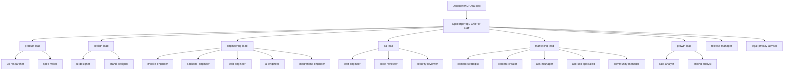

# AGENTS.md — команда AI-агентов

Команда устроена как маленькая компания. Вверху — Оркестратор (основная сессия, правила в `CLAUDE.md`). Под ним — лиды отделов. Под лидами — специалисты.

## Оргструктура



## Кто за что отвечает

| Агент | Уровень | Отвечает за | Главные документы |
|---|---|---|---|
| `product-lead` | Лид | Что строим и в каком порядке, PRD, приоритеты бэклога | `docs/01-product/`, `docs/07-operations/` |
| `ux-researcher` | Спец | Интервью, анализ отзывов и конкурентов, инсайты | `docs/01-product/research/` |
| `spec-writer` | Спец | Спецификации фич, user stories, критерии приёмки | `docs/01-product/features/` |
| `design-lead` | Лид | Визуальный язык, согласованность экранов | `docs/02-design/` |
| `ui-designer` | Спец | Экраны, состояния, макеты в HTML | `docs/02-design/screens.md`, `prototype/` |
| `brand-designer` | Спец | Имя, логотип, иконка, App Store скриншоты | `docs/02-design/brand.md` |
| `engineering-lead` | Лид | Архитектура, разбивка на задачи, ревью решений | `docs/03-architecture/` |
| `mobile-engineer` | Спец | Expo-приложение | `apps/mobile/` |
| `backend-engineer` | Спец | Схема БД, RLS, миграции, Edge Functions | `supabase/` |
| `web-engineer` | Спец | Веб-профили, вход в комнату, лендинг | `apps/web/` |
| `ai-engineer` | Спец | AI-помощник: промпты, инструменты, оценка качества | `supabase/functions/ai-assistant/`, `docs/03-architecture/ai-assistant.md` |
| `integrations-engineer` | Спец | Apple Wallet, импорт контактов, платежи, распознавание речи | `apps/web/app/api/wallet/`, ADR-0004, ADR-0005 |
| `qa-lead` | Лид | Стратегия тестирования, приёмка | `docs/04-engineering/testing-strategy.md` |
| `test-engineer` | Спец | Автотесты, тест-планы, ручные сценарии | `apps/*/__tests__`, `docs/04-engineering/` |
| `code-reviewer` | Спец | Ревью качества кода и соответствия PRD | — |
| `security-reviewer` | Спец | Ревью RLS, авторизации, обработки персональных данных | `docs/03-architecture/security-privacy.md` |
| `marketing-lead` | Лид | Стратегия выхода на рынок, координация маркетинга | `docs/05-marketing/` |
| `content-strategist` | Спец | Контент-план, рубрики, тон | `docs/05-marketing/content-strategy.md` |
| `content-creator` | Спец | Тексты постов, сценарии Reels, креативы | `marketing/content/` |
| `ads-manager` | Спец | Рекламные кампании Meta, тесты, бюджеты | `docs/05-marketing/ads-playbook.md`, `marketing/ads/` |
| `aso-seo-specialist` | Спец | App Store страница, ключевые слова, SEO лендинга | `docs/05-marketing/aso.md` |
| `community-manager` | Спец | Работа с клубами и сообществами, партнёрства | `marketing/partners/` |
| `growth-lead` | Лид | Метрики, эксперименты, монетизация | `docs/06-business/` |
| `data-analyst` | Спец | Метрики, дашборды, анализ воронки | `docs/06-business/metrics.md` |
| `pricing-analyst` | Спец | Тарифы, юнит-экономика, тесты цен | `docs/06-business/pricing-and-plans.md` |
| `release-manager` | Лид | Сборки, TestFlight, App Store, CI/CD | `docs/04-engineering/release-process.md` |
| `legal-privacy-advisor` | Лид | Политика конфиденциальности, условия, требования Apple | `docs/03-architecture/security-privacy.md`, `docs/06-business/legal.md` |

## Handoff — формат передачи задач

Лид возвращает Оркестратору план в таком виде:

```markdown
## План: <название>
Цель: <одно предложение>
Критерий готовности: <как поймём, что сделано>

| # | Агент | Задача | Вход | Выход | Зависит от |
|---|---|---|---|---|---|
| 1 | spec-writer | Спецификация фичи «Комнаты» | PRD §4.3 | docs/01-product/features/rooms.md | — |
| 2 | backend-engineer | Таблицы rooms, room_members + RLS | шаг 1 | миграция 0003 | 1 |
| 3 | mobile-engineer | Экран комнаты | шаг 1 | apps/mobile/app/room/[code].tsx | 1 |

Решения, нужные от основателя: <список или «нет»>
Риски: <кратко>
```

Специалист возвращает:

```markdown
## Результат: <задача>
Сделано: <что и где (пути файлов)>
Проверка: <как проверено>
Открытые вопросы: <или «нет»>
```

## Типовые процессы

| Процесс | Команда | Цепочка |
|---|---|---|
| Новая фича | `/feature <описание>` | product-lead → spec-writer → engineering-lead → инженеры → qa-lead → code-reviewer (+security-reviewer) |
| Маркетинговая кампания | `/campaign <цель>` | marketing-lead → content-strategist → content-creator + ads-manager → growth-lead (метрики) |
| Релиз | `/release` | qa-lead → release-manager → aso-seo-specialist (тексты обновления) |
| Статус проекта | `/status` | Оркестратор читает roadmap, backlog, decisions-log и git log |
| План спринта | `/sprint` | product-lead + engineering-lead → обновлённый backlog |
