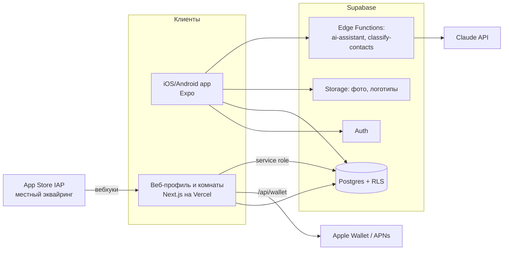

# Архитектура

## Обзор

## Компоненты
| Компонент | Технология | Ответственность |
|---|---|---|
| `apps/mobile` | Expo SDK, React Native, TypeScript, Expo Router, TanStack Query | Все экраны приложения, импорт контактов (`expo-contacts`), сканер QR (`expo-camera`), распознавание речи (`expo-speech-recognition`) |
| `apps/web` | Next.js (App Router), Vercel | Публичный профиль `/<handle>`, комната `/r/<code>`, vCard, генерация `.pkpass` (`/api/wallet`), вебхуки оплаты, лендинг |
| `supabase` | Postgres, RLS, Auth, Storage, Edge Functions (Deno) | Данные, доступы, AI-функции |
| `packages/shared` | TypeScript | Типы домена, константы разделов и тарифов, генерированные типы БД |

## Ключевые потоки
1. **Обмен профилем:** QR → `/<handle>` (SSR, кеш) → vCard или deep link `smartcontacts://person/<id>` / App Clip.
2. **Комната:** создатель → `rooms` + `code` → гость `/r/<code>` → `room_members` → у всех участников появляются контакты с `source=room`.
3. **AI-помощник:** приложение → Edge Function `ai-assistant` (JWT пользователя) → функция сама читает контакты пользователя (RLS) → собирает компактный каталог без телефонов → Claude API → JSON → сохраняет `ai_messages` → ответ клиенту.
4. **Импорт контактов:** приложение читает выбранные контакты → пакетами по 200 в `classify-contacts` → раздел для каждого → `contacts`.
5. **Wallet:** приложение → `/api/wallet?token` → подписанный `.pkpass`; изменение профиля → push в APNs → Wallet запрашивает новую версию.

## Окружения
`local` (supabase start) · `staging` (отдельный проект Supabase, preview Vercel, TestFlight) · `production`.

## Решения
См. `adr/`: 0001 Expo, 0002 Supabase, 0003 AI через сервер, 0004 Wallet, 0005 оплата.
